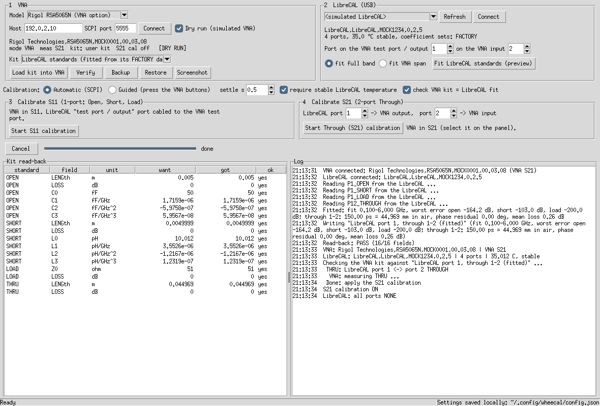

# wheecal

A companion app for the [LibreCAL](https://github.com/jankae/LibreCAL) electronic calibration kit. It calibrates
VNAs that the LibreCAL can't drive directly:

- It fits the LibreCAL's stored standards to the VNA's cal-kit model. Then it writes that kit into the VNA over
  SCPI and reads every field back.
- It runs the VNA's own calibration with the LibreCAL presenting each standard:
  - **S11**: 1-port Open, Short, Load.
  - **S21**: 2-port Through.

  In **automatic** mode wheecal also sends the VNA's measure and apply commands. In **guided** mode it switches
  the LibreCAL and tells you which button to press on the VNA.

It has a GUI and a command line, and runs on macOS, Windows and Linux.

> wheecal is an independent project. It is not affiliated with or endorsed by Rigol or the LibreCAL project.

## Supported hardware

| VNA | Calibrations | Driver |
|---|---|---|
| Rigol RSA5065N with the VNA option (RSA5000 VNA mode) | S11 Open/Short/Load, S21 Through | `rsa5065n` |

Other VNAs plug in through a small driver interface: see [docs/adding-a-vna.md](docs/adding-a-vna.md). The LibreCAL
side is shared by every driver.

## Install

**From a release:** download the archive for your system from
[Releases](https://github.com/CoolNamesAllTaken/wheecal/releases) and unpack it.
- **macOS:** open `wheecal.app`. The app isn't notarized, so the first time, right-click it and choose *Open*.
- **Windows:** run `wheecal\wheecal.exe`. For the command line, use `wheecal-cli.exe`.
- **Linux:** run `wheecal/wheecal`.

The LibreCAL is a USB serial device and needs no driver.

**From source** (Python 3.9+ with Tk):

```bash
git clone https://github.com/CoolNamesAllTaken/wheecal && cd wheecal
python3 -m venv .venv && source .venv/bin/activate
pip install -r requirements.txt          # pyserial is the only dependency
python3 -m wheecal                       # GUI; any argument runs the command line
```

To build the standalone app yourself, see [docs/building.md](docs/building.md).

## Wiring

```
computer USB ───────── LibreCAL USB-C    power and control; wait until it is at temperature (its LED)
computer network ───── VNA               the VNA's SCPI socket (RSA5065N: TCP 5555)

S11 (1-port)   LibreCAL port 1 ──── VNA port 1 / output   (RSA5065N: GEN OUTPUT 50Ω)
S21 (2-port)   LibreCAL port 1 ──── VNA port 1 / output   (RSA5065N: GEN OUTPUT 50Ω, the tracking generator)
               LibreCAL port 2 ──── VNA port 2 / input    (RSA5065N: RF INPUT 50Ω)
```

- You can cable any LibreCAL ports; tell wheecal which ones in the GUI or with `--librecal-port` and
  `--through-port`.
- Calibrate through the cables and adapters you will measure with. The calibration plane is the LibreCAL's
  connectors.
- Select the measurement on the VNA's panel yourself: VNA mode, then S11 or S21. wheecal checks it but never
  changes it.

## Configuration

Settings are stored per user and created on the first run. They contain no instrument address until you enter one.

| System | File |
|---|---|
| macOS | `~/Library/Application Support/wheecal/config.json` |
| Linux | `~/.config/wheecal/config.json` (or `$XDG_CONFIG_HOME`) |
| Windows | `%APPDATA%\wheecal\config.json` |

- The file holds the driver, VNA host and SCPI port, LibreCAL serial port (or `auto`), LibreCAL ports, settle
  times and the last-used mode. [`config.example.json`](config.example.json) shows every key.
- The GUI saves the file when you connect or calibrate. Command-line flags override it for one run without saving.
- To use another file, pass `--config <file>` or set `WHEECAL_CONFIG`. `wheecal --show-config` prints where the file
  is.

## Safety

- **Nothing runs on launch.** Every action is a button or a flag, and calibrations ask first (or need `--yes`).
- **Limited writes.** wheecal only writes cal-kit fields and calibration steps. Each driver refuses anything else
  before it is sent. wheecal never changes span, points, IF bandwidth, source power, mode or measurement, never
  presets, and never clears a calibration.
- **Pick the right kit.** A calibration replaces the VNA's current one for that measurement, and the VNA solves it
  with its selected kit. Load the *LibreCAL standards* kit first. wheecal reads it back before calibrating and
  stops if it differs.
- **Check the first calibration on your bench.** The RSA5065N calibration commands come from the instrument's own
  SCPI tree and help, and the LibreCAL commands from its source code. Neither has been run end to end against
  hardware by this project yet. Do the first run in **guided** mode, or watch the VNA screen in automatic mode.
  Afterwards, measure a known load, open or through.

## Documentation

- [User guide](docs/user-guide.md): S11 and S21 step by step, automatic and guided mode, and the command line.
- [Adding a VNA](docs/adding-a-vna.md)
- [Building](docs/building.md): standalone app and releases.
- [RSA5065N and LibreCAL command notes](docs/rsa5065n.md)
- [Changelog](CHANGELOG.md)



## License

MIT, see [LICENSE](LICENSE).
